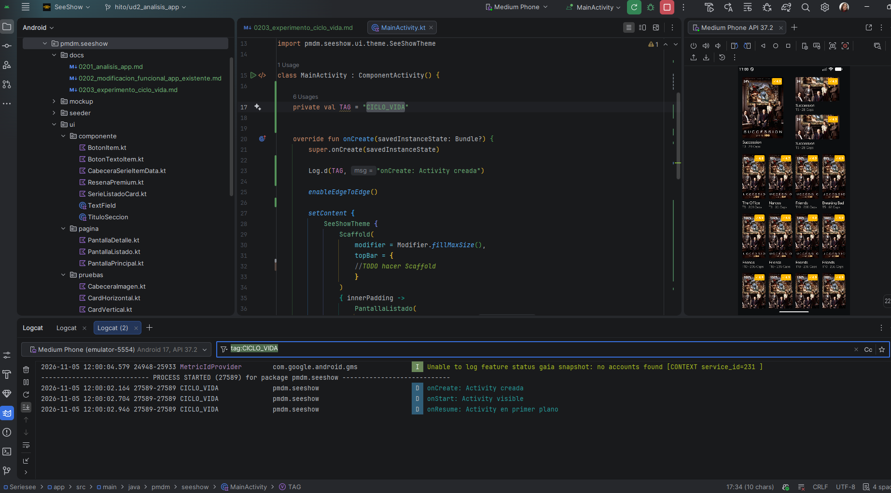
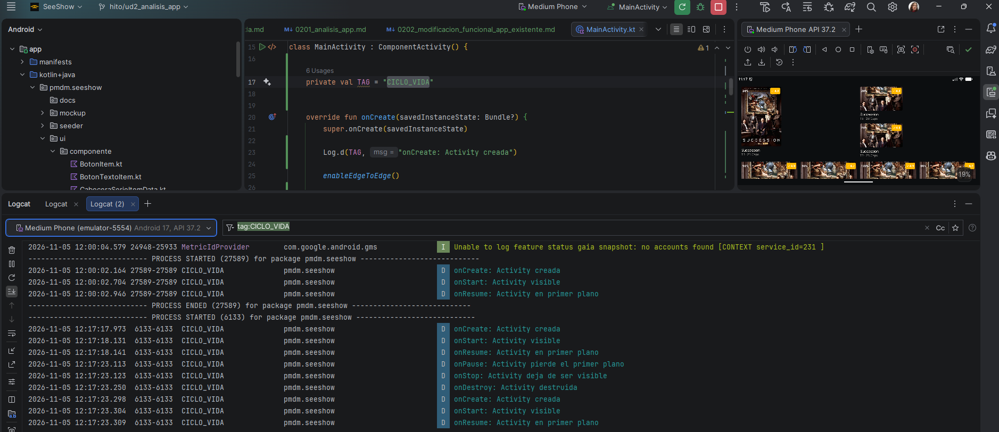
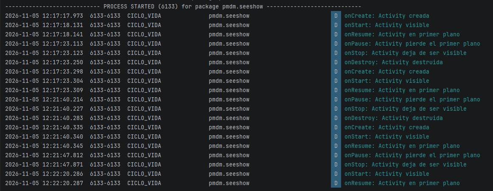
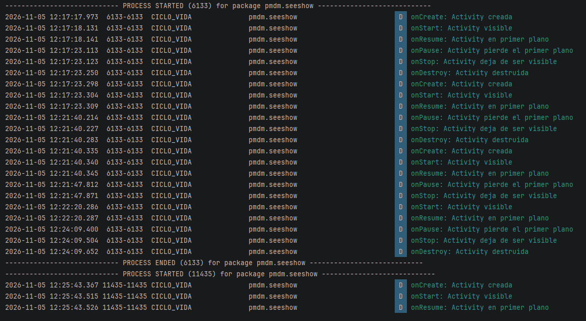
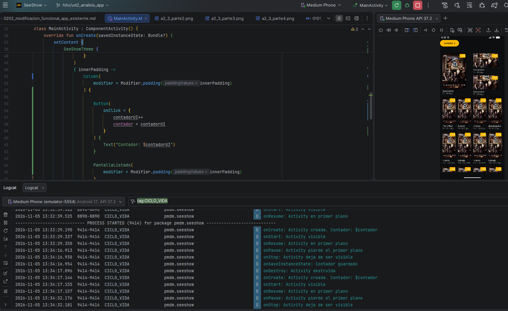
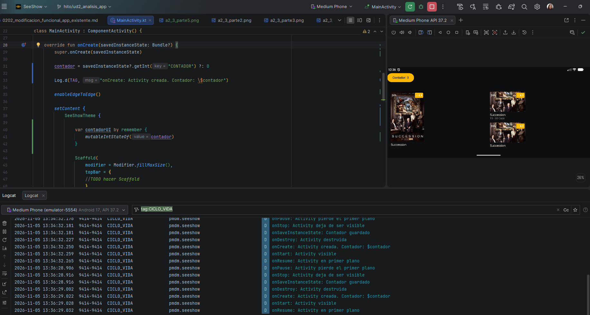

# A2.3 · Experimento de ciclo de vida

Objetivo: observar de primera mano las transiciones de estado de una Activity.

Sobre un proyecto propio (puede ser el esqueleto del Proyecto A si ya existe, o un proyecto de prueba), añade trazas de Log.d en todos los callbacks del ciclo de vida (onCreate, onStart, onResume, onPause, onStop, onDestroy).

### Con Logcat abierto, provoca y registra al menos estas situaciones

Arranque normal de la app.



Girar la pantalla.



Pulsar el botón de inicio y volver a la app.



Cerrar completamente la app y reabrirla.




Código de onSaveInstanceState y una comprobación de que funciona.




Clico el botón 3 veces para que muestre tres y al girar la pantalla sigue mostrando 3

## Código usado
```kotlin
class MainActivity : ComponentActivity() {

    private val TAG = "CICLO_VIDA"
    private var contador = 0


    override fun onCreate(savedInstanceState: Bundle?) {
        super.onCreate(savedInstanceState)

        contador = savedInstanceState?.getInt("CONTADOR") ?: 0

        Log.d(TAG, "onCreate: Activity creada. Contador: \$contador")

        enableEdgeToEdge()

        setContent {
            SeeShowTheme {

                var contadorUI by remember {
                    mutableIntStateOf(contador)
                }

                Scaffold(
                    modifier = Modifier.fillMaxSize(),
                    topBar = {
                        //TODO hacer Scaffold
                    }
                )
                { innerPadding ->
                    Column(
                        modifier = Modifier.padding(innerPadding)
                    ) {

                        Button(
                            onClick = {
                                contadorUI++
                                contador = contadorUI
                            }
                        ) {
                            Text("Contador: $contadorUI")
                        }

                        PantallaListado(
                            modifier = Modifier.padding(innerPadding)
                        )
                    }
                }
            }
        }
    }

    override fun onSaveInstanceState(outState: Bundle) {
        super.onSaveInstanceState(outState)

        outState.putInt("CONTADOR", contador)

        Log.d(TAG, "onSaveInstanceState: Contador guardado")
    }

    override fun onStart() {
        super.onStart()
        Log.d(TAG, "onStart: Activity visible")
    }

    override fun onResume() {
        super.onResume()
        Log.d(TAG, "onResume: Activity en primer plano")
    }

    override fun onPause() {
        super.onPause()
        Log.d(TAG, "onPause: Activity pierde el primer plano")
    }

    override fun onStop() {
        super.onStop()
        Log.d(TAG, "onStop: Activity deja de ser visible")
    }

    override fun onDestroy() {
        super.onDestroy()
        Log.d(TAG, "onDestroy: Activity destruida")
    }
}
```